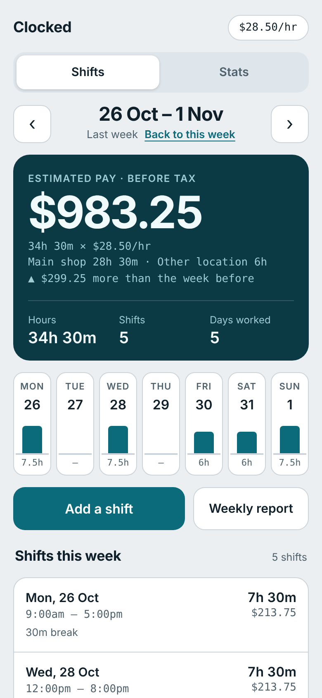
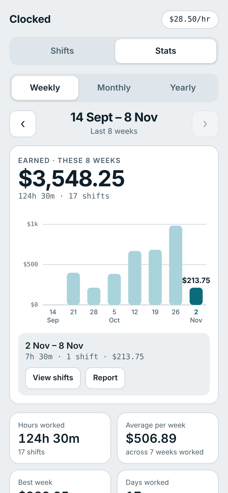
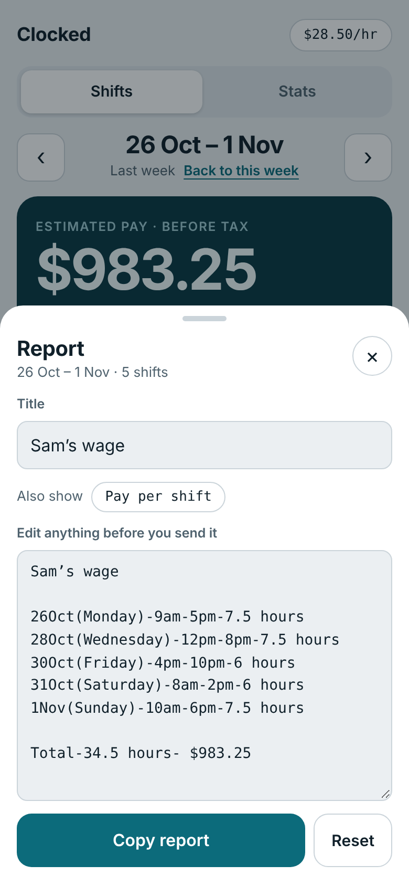
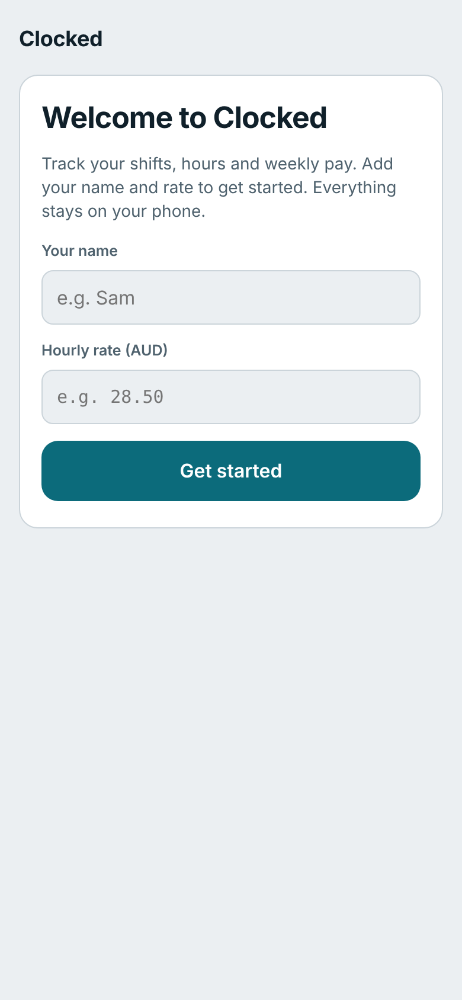

<p align="center">
  
</p>

<h1 align="center">Clocked</h1>

<p align="center">
  Log your shifts, see your hours, and know what you'll get paid this week.<br>
  A small web app for casual and part-time workers that installs on your phone like a normal app.
</p>

<p align="center">
  <a href="https://omerfauzan.github.io/clocked/"><b>Open Clocked</b></a>
</p>

---

## Why I made this

I work casual shifts while studying, and I was keeping track of my hours in notes and doing the pay maths by hand every week. I wanted one place that shows what days I worked, how many hours, and what I'm getting paid, plus a quick way to send a summary on WhatsApp. So I built it, and then cleaned it up so my friends could use it too.

## Screenshots

| Weekly view | Stats | Report | First run |
|---|---|---|---|
|  |  |  |  |

<sub>Screenshots use made-up sample shifts.</sub>

## What it does

**Shifts**
- Add a shift with date, start, finish and unpaid break. Overnight shifts work too.
- Tag a shift as your main workplace or another location.
- See the week at a glance: estimated pay, hours, shifts and days worked, plus a Mon to Sun strip showing hours per day.
- Shows how much more or less you made than the week before.
- Change your hourly rate any time. Shifts you already logged keep the rate they were saved with, so old weeks don't change.

**Stats**
- Earnings as a bar chart. **Weekly** shows the weeks of one month (use the arrows to move between months), **Monthly** shows Jan to Dec, and **Yearly** shows every year. Tap any bar to see that period.
- Hours worked, average per week or month, your best week or month, and days worked.
- Hours by day of the week, so you can see which days you usually work.

**Reports**
- One tap builds a text report for the week, ready to paste into WhatsApp or anywhere else:

  ```
  Sam’s wage

  26Oct(Monday)-9am-5pm-7.5 hours
  28Oct(Wednesday)-12pm-8pm-7.5 hours
  30Oct(Friday)-4pm-10pm-6 hours

  Total-21 hours- $598.50
  ```

- Edit anything before sending. You can also add the pay for each shift.
- Copy it, or use Share to send it straight to another app.
- Works for a month or a whole year too, from the Stats tab.
- If a period has shifts at both your main workplace and another location, you get a separate report for each. Switch between **Main shop**, **Other location** and **Both**, and each location keeps its own title.

**Everything else**
- Installs on your home screen and opens full screen like an app.
- Works offline.
- Light and dark mode follow your phone's setting.

## Install it on your phone

**iPhone**
1. Open [omerfauzan.github.io/clocked](https://omerfauzan.github.io/clocked/) in **Safari**.
2. Tap **Share**, then **Add to Home Screen**.

**Android**
1. Open the link in **Chrome**.
2. Tap **⋮**, then **Add to Home screen** (or **Install app**).

The first time you open it, it asks for your name (used in reports) and your hourly rate.

## Your data

There's no account and no server. Your shifts are saved in your phone's browser storage and never leave your phone. That also means:

- If you delete the app's website data or clear Safari history, your shifts go with it.
- Use **Backup and restore** at the bottom of the app now and then. **Copy backup** gives you a block of text you can keep in Notes or send to yourself. Paste it back into **Restore** to get everything back, including on a new phone.

Pay is an estimate before tax. It doesn't include penalty rates, overtime or super.

## How it's built

No frameworks and no build step, just plain HTML, CSS and JavaScript.

| File | What it does |
|---|---|
| `index.html` | The whole app: layout, styles and logic |
| `sw.js` | Service worker that caches the app so it opens instantly and works offline |
| `manifest.webmanifest` | Lets phones install it as an app (name, colours, icons) |
| `icon-180.png`, `icon-192.png`, `icon-512.png` | App icons |
| `docs/screenshots/` | Images for this README |

- Data is stored in `localStorage` under keys starting with `clocked-`.
- Charts are drawn as plain SVG, with no chart library.
- Money is worked out in cents to avoid rounding errors.

## Run it locally

The service worker needs a real server, so don't open the file directly:

```bash
git clone https://github.com/Omerfauzan/clocked.git
cd clocked
python3 -m http.server 8000
```

Then open http://localhost:8000.

## Updating

If you change `index.html`, bump the `CACHE` name in `sw.js` (for example `clocked-v3` to `clocked-v4`). Otherwise phones keep showing the cached old version. After pushing, close and reopen the app twice to pick up the update.

## Ideas for later

- Penalty rates for weekends and public holidays
- More than one job with different rates
- Tracking the 48 hours per fortnight work limit for student visa holders
- Checking a payslip against what you should have been paid
- Accounts and sync across devices

---

Made by [Omer Fauzan](https://github.com/Omerfauzan).
